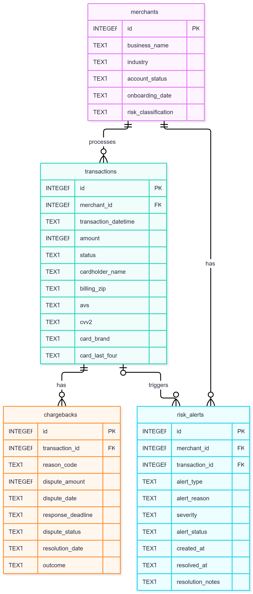

# Payment Risk & Fraud Monitoring Database

## Scope
The purpose of the Payment Risk & Fraud Monitoring Database is to provide risk analysts with access to merchant, transaction, chargeback, and risk alert data to support effective risk reviews.

The database is designed to help analysts identify potentially fraudulent activity, monitor merchant risk, investigate transaction patterns, and review chargeback activity. Its primary goal is to support informed risk management decisions and help mitigate financial losses for both merchants and the payment processor.

### Out Of Scope
The database is designed to support human-led risk analysis and investigations rather than automated fraud prevention or transaction decisioning.

It does not automatically approve or decline transactions, restrict merchant accounts, or generate risk alerts in real time. Instead, it provides structured data and SQL queries that analysts can use to identify potentially suspicious activity, monitor chargebacks, and support informed risk management decisions.

## Entities
### Merchants
The merchants table stores information about businesses that process payments through the payment processor.

Each merchant has a unique identifier, business name, industry, account status, onboarding date, and risk classification.

The account_status and risk_classification fields provide important context during merchant risk reviews. Analysts can use this information alongside transaction activity, chargeback history, and risk alerts to determine the appropriate level of investigation and monitoring.

The merchant's unique identifier also establishes relationships with transactions and risk alerts, allowing analysts to review activity associated with a specific business.
### Transactions
The transactions table stores individual payment transactions associated with merchants.

Each transaction includes a unique identifier, merchant identifier, transaction date and time, amount, status, cardholder name, billing ZIP code, AVS result, CVV2 result, card brand, and the last four digits of the payment card.

The AVS and CVV2 verification results provide important information for transaction risk reviews. These fields help analysts identify potential discrepancies between submitted payment information and the card issuer's records, which may indicate suspicious or potentially fraudulent activity.

Analysts can evaluate these results alongside transaction amounts, statuses, and activity patterns to determine whether further investigation is warranted.

Each transaction is linked to a merchant through the merchant_id foreign key, allowing analysts to investigate payment activity associated with a specific business.
### Chargebacks
The chargebacks table stores information about payment disputes associated with individual transactions.

Each chargeback includes a unique identifier, transaction identifier, reason code, dispute amount, dispute date, response deadline, dispute status, resolution date, and outcome.

The dispute_status field allows analysts to track where a chargeback is in the dispute lifecycle, while the outcome field records how the dispute was ultimately resolved. Maintaining both fields helps analysts monitor outstanding disputes, manage response deadlines, and provide accurate information to merchants regarding their chargeback cases.

The table also supports historical analysis of dispute activity and outcomes, helping analysts identify patterns that may indicate increased merchant risk.

Each chargeback is linked to its original transaction through the transaction_id foreign key, allowing analysts to identify the merchant associated with the disputed payment.
### Risk Alerts
The risk_alerts table stores information about potential merchant-level and transaction-level risks that require analyst attention.

Each alert includes a unique identifier, merchant identifier, optional transaction identifier, alert type, alert reason, severity, status, creation date and time, resolution date and time, and resolution notes.

The severity field helps analysts assess the priority of an investigation, while the alert_status field indicates whether an alert is open, under review, resolved, or dismissed.

Maintaining both fields allows analysts to identify outstanding investigations, prioritize higher-risk activity, and distinguish alerts requiring attention from those already addressed.

Every alert is associated with a merchant through the merchant_id foreign key. Transaction-level alerts are also linked to a specific transaction through transaction_id, allowing analysts to investigate suspicious activity at either level.

## Relationships
### Transactions and Chargebacks
The relationship between transactions and chargebacks is one-to-many.

Each chargeback is associated with a specific transaction through the transaction_id foreign key. A transaction may have zero, one, or multiple associated chargeback records.

This design allows analysts to review dispute activity associated with individual transactions, including cases where multiple dispute records are associated with the same payment.
### Merchants and Transactions
The relationship between merchants and transactions is one-to-many.

A merchant can process multiple transactions, but each transaction is associated with one merchant through the merchant_id foreign key.

This relationship allows analysts to retrieve transaction histories for individual merchants, investigate suspicious payment activity, and evaluate transaction patterns that may indicate increased financial risk.
### Merchants, Transactions, and Risk Alerts
The risk_alerts table has a one-to-many relationship with the merchants table. A merchant can have multiple risk alerts, but each alert is associated with one merchant through the merchant_id foreign key.

The risk_alerts table also has an optional relationship with the transactions table. Transaction-level alerts reference a specific transaction, while merchant-level alerts do not require a transaction reference.

This design allows analysts to investigate both individual suspicious transactions and broader merchant-level risk concerns, such as unusual processing patterns or elevated chargeback activity.

A CHECK constraint ensures that transaction-level alerts include a transaction_id, while merchant-level alerts have a NULL transaction reference.
### Entity Relationship Diagram

## Design Decisions
### Monetary Values
Transaction amounts and chargeback dispute amounts are stored as integers representing cents rather than floating-point dollar values.

This design helps prevent floating-point rounding errors during financial calculations and maintains accurate monetary values in the database.

For example, a transaction of $149.95 is stored as 14995 cents. Amounts can be converted into dollars when needed for reporting or display.
### Card Identification
The card_last_four column is stored as TEXT rather than INTEGER to preserve leading zeros in payment card identifiers.

For example, the last four digits 0042 would become 42 if stored as an integer, resulting in inaccurate card identification.

A CHECK constraint ensures that the field contains exactly four numeric digits.

The database stores only the last four digits of the payment card and the CVV2 verification result, rather than the complete card number or security code.
### Billing ZIP Codes
The billing_zip column is stored as TEXT rather than INTEGER to preserve leading zeros in ZIP codes.

ZIP codes are geographic identifiers rather than numerical values used in calculations. Storing them as text ensures accurate representation and supports ZIP+4 formats when needed.
### Data Integrity and CHECK Constraints
The database uses NOT NULL, CHECK, primary key, and foreign key constraints to maintain data integrity.

CHECK constraints restrict certain columns to predefined values, including merchant account statuses, risk classifications, transaction statuses, and alert severity levels.

These constraints prevent unsupported values from being stored and help maintain consistent data for risk analysis and reporting.
### Foreign Key Constraints
Foreign key constraints maintain referential integrity between merchants, transactions, chargebacks, and risk alerts.

For example, every transaction must reference an existing merchant through the merchant_id foreign key.

These constraints prevent records from referencing nonexistent parent records, helping analysts reliably connect payment activity, disputes, and risk alerts to the appropriate merchant or transaction.

SQLite foreign key enforcement must be enabled using PRAGMA foreign_keys = ON for each database connection.
### Nullable Fields and Chargeback Resolution
The chargebacks table allows NULL values in the resolution_date and outcome columns because this information is not available until a dispute has been resolved.

A CHECK constraint ensures that resolved chargebacks have both a resolution date and an outcome, while unresolved chargebacks have neither.

This design reflects the chargeback lifecycle and prevents inconsistent dispute records.

## Optimizations
### Transaction Merchant Index
An index named idx_transactions_merchant_id was created on the merchant_id column in the transactions table.

This index supports queries that retrieve transactions associated with a specific merchant.

As transaction volume increases, the index can help SQLite locate matching transactions more efficiently without scanning the entire transactions table.
### Chargeback Response Deadline Index
An index named idx_chargebacks_response_deadline was created on the response_deadline column in the chargebacks table.

This index supports queries that identify chargebacks approaching their response deadlines or already overdue.

Efficient deadline monitoring allows analysts to prioritize time-sensitive disputes, helping reduce the risk of missed response deadlines and potential financial losses.

## Limitations
### Manual Risk Review and Decision-Making
The Payment Risk & Fraud Monitoring Database is designed to support human analysts in reviewing merchant activity, transactions, chargebacks, and risk alerts.

Although the database allows analysts to identify suspicious patterns and prioritize investigations, it does not automatically detect fraud, generate alerts, decline transactions, or restrict merchant accounts.

Final risk decisions remain the responsibility of authorized analysts or other personnel. The database provides information to support those decisions rather than making them automatically.
### Risk Alert Merchant and Transaction Consistency
The risk_alerts table contains foreign keys referencing both merchants and transactions.

Although these foreign keys ensure that referenced records exist, the current schema does not enforce that a transaction-level alert's transaction_id belongs to the merchant specified by its merchant_id.

This could result in an alert incorrectly associating a merchant with another merchant's transaction.

A future improvement could introduce additional database constraints or validation logic to ensure that transaction-level alerts reference transactions belonging to the correct merchant.
### Limited Sample Data
The database currently contains a small set of fictional sample records representing merchants, transactions, chargebacks, and risk alerts.

Although these records demonstrate the database's functionality and support testing of its queries, they do not represent the volume or variety of activity found in a production payment processing environment.

Additional sample merchants, transactions, and disputes would be needed to evaluate query behavior across different merchant scenarios.

Larger datasets would also be necessary to assess database performance and the effectiveness of indexes at scale.

## Video Demonstration

A walkthrough of the Payment Risk & Fraud Monitoring Database, including its database structure, design decisions, SQL queries, and limitations.

[Watch the CS50 SQL Final Project Demonstration](https://youtu.be/L0X7NkLR9g4)
